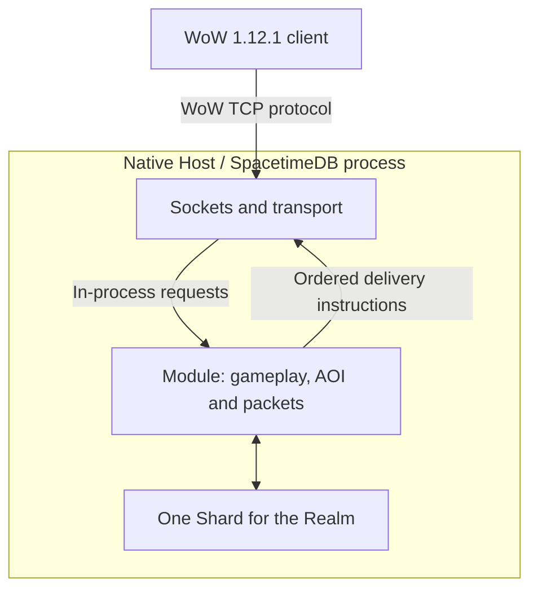

<p align="center"><h1 align="center">LyraCore</h1><h3 align="center">A vanilla server built for change
</h3></p>


LyraCore is a World of Warcraft 1.12.1 server written in Rust on [SpacetimeDB](https://spacetimedb.com/).
All game state and rules live in the database. You add content with Packages, without editing core
files, and players connect with an unmodified client.

> **Not ready for deployment.**
> LyraCore is in an early phase of development and is not secure. Do not use it for a public realm.

## Quickstart

### Requirements
- A World of Warcraft 1.12.1 client, build 5875. None is distributed here.
- [Rust](https://rust-lang.org/tools/install/) through rustup. `rust-toolchain.toml` pins 1.93.0, and rustup installs it on the first `cargo` call.
- The SpacetimeDB CLI, exactly version 2.7.1. `module/Cargo.toml` pins it, and `lyracore preflight` refuses any other version. `install.sh` offers to install it.
- A Linux or macOS machine or container. On Windows, use WSL2 with Ubuntu; see [`docs/windows.md`](docs/windows.md).

### Installing
```bash
curl -sSfL https://raw.githubusercontent.com/LyraCoreProject/LyraCore/main/install.sh | sh
cd LyraCore
```
The script puts the LyraCore folder in your current directory and a launcher for the
[lyracore CLI](https://github.com/LyraCoreProject/lyracore-cli) in `~/.local/bin`. It offers to
install Rust, SpacetimeDB 2.7.1 and `wasm-opt` if they are missing. Nothing needs root.

```bash
lyracore doctor                  # is this machine ready?
lyracore dev up                  # start the local realm
lyracore account create admin    # a login for your client
```
Point your client's `realmlist.wtf` at `127.0.0.1` and log in. The realm starts with a small seed
world. Import the real one next.

### Importing data
```bash
lyracore config set client-data <path-to-client-Data-folder>
lyracore import
```
You supply your own client's `Data` folder. After you confirm the prompt, `lyracore import`
downloads the current SQLite snapshot from [vmangos](https://github.com/vmangos/core), verifies
GitHub's asset digest, and checks its Source Profile before import. It records the actual source
commit and combines the world data with the remaining catalogues and geometry from your client.

See the [detailed import instructions](./docs/quickstart.md#getting-the-real-world) for what
the import loads and how long it takes.

## Can I use my existing client?

Yes. An unmodified 1.12.1 client, build 5875, is the only client LyraCore supports. Nothing is
patched, no launcher is replaced, and no addon is required. Other 1.12.x builds fail at the logon
challenge or during the handshake.

## Packages

A Package is a folder under `packages/` that adds content to the realm. It can hold Runtime Scripts
in TypeScript or Lua, data changes, client addons, Rust code, or any mix of these.

```bash
lyracore packages new my-package    # start your own
lyracore packages add playerbots    # install an official one
lyracore packages apply             # build and activate enabled Packages
```

The official Packages live in [LyraCoreProject/packages](https://github.com/LyraCoreProject/packages).
[Applying packages](./packages/README.md#applying-packages) explains what the command changes.
[`docs/package-api.md`](./docs/package-api.md) lists what a Package's Rust code may call.

## Architecture

Unmodified WoW 1.12.1 clients connect to the Native Host's logon and world TCP listeners.
The SpacetimeDB Module owns authentication decisions, request handling, gameplay, AOI and packet
construction. The host handles sockets, entropy, framing, ciphers and ordered delivery.
One Shard holds the Realm's Accounts, Characters, maps, Instances and shared state.



The native runtime is the local development default. The Gateway crate has been removed. [`docs/architecture.md`](./docs/architecture.md#native-host-migration) records coverage
and the remaining work. Existing multi-Shard Realm data requires a separate migration.
To move a local Realm, a branch or a Package from the Gateway, read
[`docs/migrating-to-native-host.md`](./docs/migrating-to-native-host.md) or run `/migrate-native-host`.

## Contributing

Anyone can open an issue or a pull request. Start with [`CONTRIBUTING.md`](./CONTRIBUTING.md). It
names the three required reads and explains how to file an issue or a pull request.
[`docs/quickstart.md`](./docs/quickstart.md) goes from a clone to a connected client.

## Credits

LyraCore is an independent implementation, not a fork or port of another emulator. It relies on
knowledge and data from other projects: [wowdev.wiki](https://wowdev.wiki) for wire formats, the
gtker crates as dependencies, and vMaNGOS, cMaNGOS and mangoszero as references for which packets
a client needs and in what order. Without these projects, none of this would be possible.

## License

Dual-licensed under [MIT](./LICENSE-MIT) or [Apache 2.0](./LICENSE-APACHE), at your option.
